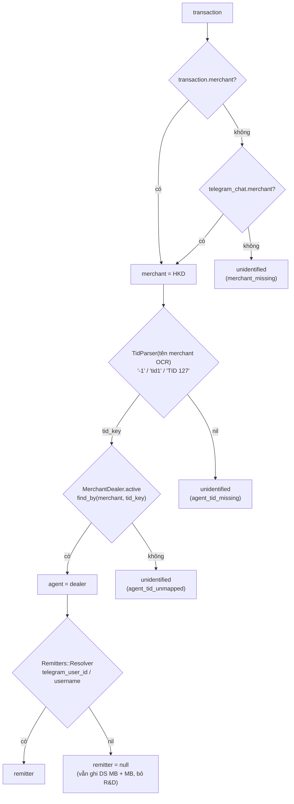
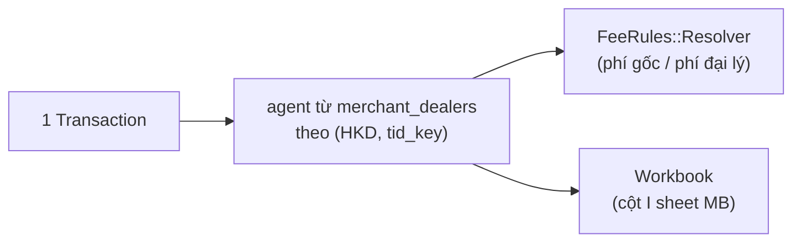

# Flow: Hello SMC workbook — ghi giao dịch vào Google Sheet

Contract chi tiết: [SPEC_HELLO_SMC_WORKBOOK.md](SPEC_HELLO_SMC_WORKBOOK.md). File này chỉ vẽ luồng.

## 1. Pipeline end-to-end

```mermaid
flowchart TD
    subgraph INGEST["1 · Nhận bill (Telegram)"]
        A["📷 Bill ảnh vào group Telegram"] --> B["ProcessTelegramUpdateJob<br/>→ Telegram::UpdateReceiver"]
        B --> C["Tạo TelegramMessage<br/>(telegram_username, telegram_sender_id)"]
        C --> D["DownloadTelegramAttachmentJob<br/>→ tạo BillImage (đính ảnh)"]
        M["🖥 Upload tay (web)"]
        M --> E
    end

    subgraph OCR["2 · OCR / Vision"]
        D --> E["AnalyzeBillImageJob<br/>→ BillImages::Analyzer"]
        E --> F["BillImage.documents / extraction<br/>(merchant_name, terminal_or_merchant_id, amount, …)"]
    end

    subgraph BUILD["3 · Tạo transaction"]
        F --> G["BuildTransactionJob<br/>→ Transactions::Builder"]
        G --> G1["Dealers::Resolver (chat→dealer)<br/>→ transaction.dealer_id<br/><i>PHA 1: chỉ cho fee rule</i>"]
        G --> G2["Evaluator: merchant + card_type + fee_rule<br/>→ approved / needs_review / failed"]
        G2 --> G3{"có amount<br/>và không failed?"}
        G3 -- "không" --> X["❌ Không enqueue workbook"]
        G3 -- "có" --> H["enqueue WriteHelloSmcWorkbookJob<br/>(queue: exports)"]
    end

    subgraph WRITE["4 · Ghi Google Sheet"]
        H --> I["HelloSmcWriter.call"]
        I --> I1{"amount? failed/rejected?<br/>đã ghi? spreadsheet_id?"}
        I1 -- "skip / fail" --> X
        I1 -- "ok" --> I2["🔒 pg_try_advisory_lock<br/>(bận → LockBusy → retry)"]
        I2 --> I3["Workbook::Resolver<br/>resolve HKD + agent(TID) + remitter"]
        I3 --> I4{"identified?<br/>(có HKD + agent)"}
        I4 -- "không" --> J["write_unidentified<br/>→ sheet 'Bill vô chủ'"]
        I4 -- "có" --> K["write_identified"]
        K --> K1["DS MB T&#123;tháng&#125;: +amount<br/>(tạo T11 nếu cần)"]
        K --> K2{"có remitter?"}
        K2 -- "có" --> K3["R&D Report: +amount<br/>ô agent × remitter"]
        K2 -- "không" --> K4["bỏ R&D"]
        K --> K5["MB: append row A…K"]
        J --> L["1 lần batchUpdate (kèm marker TX id) →<br/>tạo workbook_entries<br/>(retry thấy marker → chỉ tạo entry)"]
        K1 --> L
        K3 --> L
        K4 --> L
        K5 --> L
        L --> O["✅ Done"]
    end
```

## 2. Resolve HKD / agent / remitter (`Workbook::Resolver`)

## 3. Dealer = agent (PHA 2, đã áp dụng)

> `Dealers::Resolver` tra theo TID trên tên merchant OCR; không còn chat → dealer. Merchant chưa cấu hình `merchant_dealers` thì `dealer_unmapped` và vào `needs_review`.

## 4. Sequence diagram

```mermaid
sequenceDiagram
    autonumber
    actor U as Người gửi (Telegram)
    participant RX as UpdateReceiver
    participant DL as DownloadAttachmentJob
    participant OC as AnalyzeBillImageJob
    participant BB as Transactions::Builder
    participant DR as Dealers::Resolver
    participant EV as Evaluator
    participant WJ as WriteHelloSmcWorkbookJob
    participant WR as HelloSmcWriter
    participant RS as Workbook::Resolver
    participant DB as PostgreSQL
    participant GC as GoogleSheetClient
    participant GS as Google Sheets

    U->>RX: Gửi bill ảnh vào group
    RX->>DB: Tạo TelegramMessage<br/>(telegram_username, telegram_sender_id)
    RX->>DL: enqueue tải ảnh

    DL->>DB: Tạo BillImage (đính ảnh)
    DL->>OC: enqueue OCR

    OC->>OC: Vision → documents / extraction
    OC->>DB: Lưu extraction vào BillImage
    OC->>BB: enqueue BuildTransactionJob

    BB->>DR: resolve dealer
    DR-->>BB: dealer = chat.dealer (PHA 1)
    BB->>EV: build từng document
    EV->>DB: đọc merchant / card_type / fee_rule
    EV-->>BB: approved / needs_review / failed
    BB->>DB: Lưu transaction
    BB->>WJ: enqueue (có amount & không failed)

    WJ->>WR: call(transaction)
    WR->>WR: guard: amount? failed? đã ghi? spreadsheet_id?
    opt hợp lệ
        WR->>DB: pg_advisory_lock(spreadsheet_id)
        WR->>DB: check workbook_entries đã tồn tại?
        WR->>RS: resolve HKD + agent + remitter
        RS->>DB: tra merchant_dealers theo (HKD, tid_key)
        RS->>DB: tra remitters theo telegram id / username
        RS-->>WR: identified / unidentified

        alt unidentified
            WR->>GC: append 'Bill vô chủ'
        else identified
            WR->>GC: đọc 'DS MB T&#123;tháng&#125;' (tạo T11 nếu cần)
            GC->>GS: get_values + duplicate_sheet
            WR->>GC: +amount vào ô ngày × agent
            opt có remitter
                WR->>GC: +amount vào ô agent × remitter (R&D)
            end
            WR->>GC: append row 'MB' (A…K)
        end

        WR->>GC: batch_update_values (1 lần, mọi ô)
        GC->>GS: values.batchUpdate
        WR->>DB: tạo workbook_entries (idempotent)
        WR->>DB: pg_advisory_unlock
    end
    WR-->>WJ: result
```

